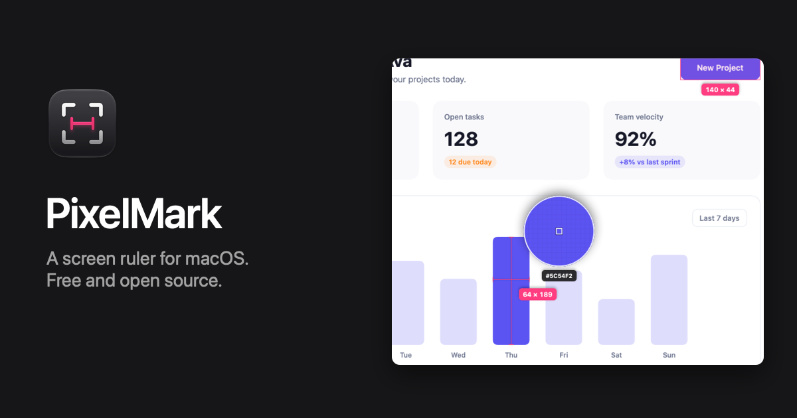

# PixelMark

A free, open source screen ruler for macOS. Press **⇧⌘2**, hover, and PixelMark shows the distance to the nearest edges in every direction. Drag a box and it snaps to the content inside. Inspired by [PixelSnap](https://pixelsnap.com).

**[Download PixelMark](https://github.com/nearbycoder/pixelmark/releases/latest/download/PixelMark.dmg)** · [Website](https://nearbycoder.github.io/pixelmark/) · [Watch the one-minute tour](https://nearbycoder.github.io/pixelmark/#tour) · requires macOS 26 Tahoe or later · signed with a Developer ID and notarized by Apple

## Features

- **Hover to measure.** Lines run from the pointer to the nearest edge in each direction, labeled with the width and height.
- **Boxes that snap.** Drag around anything and the box shrinks to fit the content. Hold ⇧ for a free box.
- **Spacing.** Hold ⌥ over a box to see the gaps to its neighbors, or to the next edge on screen. Aligned boxes get alignment lines.
- **Guides.** Press H or V for a horizontal or vertical guide, with the distance between neighboring guides.
- **Loupe and colors.** A magnified view of the pixels under the pointer. Press C to copy the hex color.
- **Copy formats.** ⌘C copies `320 × 48`, `320x48`, CSS or a SwiftUI `.frame`.
- **Screenshots.** ⌘S saves and copies the screen with every measurement on it; ⇧⌘S crops to the measured area.
- **Points or pixels,** adjustable edge tolerance, and every connected display.

PixelMark takes one still image of each display when you start measuring and discards it when you finish. It has no network access, analytics or account.

## Shortcuts

| Key | Action |
| --- | --- |
| ⇧⌘2 | Start measuring (customizable) |
| Drag / ⇧ Drag | Box that snaps to content / free box |
| Click or Space | Pin the current measurement |
| ⌥ | Spacing around the hovered box |
| H / V | Horizontal / vertical guide |
| ⌘C / C | Copy dimensions / copy color |
| ⌘S / ⇧⌘S | Screenshot / cropped screenshot |
| [ / ] | Edge tolerance |
| U / L | Points ↔ pixels / toggle loupe |
| Arrow keys | Nudge 1 px (⇧ for 10) |
| ⌫ or ⌘Z / X | Remove hovered or last mark / clear all |
| ? | Show every shortcut |
| Esc | Done |

## Building

```sh
brew install xcodegen
xcodegen generate
open PixelMark.xcodeproj
```

Run the tests with `xcodebuild test -project PixelMark.xcodeproj -scheme PixelMark -destination 'platform=macOS'`.

`./Scripts/release.sh` archives, signs with Developer ID, notarizes and packages a DMG; `./Scripts/release.sh publish` also tags the version and creates a GitHub release. Bump the version in `Resources/Info.plist` first.

Debug builds can drive the overlay from a script for screenshots, without covering your screen: `./Scripts/shoot.sh <backdrop.png> <out.png> "drag 100 100 300 200; option 150 150"`. `Scripts/make-demo-backdrop.swift` renders the mock desktop used on the website, and `./Scripts/record-demo.sh` records the feature tour video (`docs/assets/demo.mp4`) the same way.

## License

[MIT](LICENSE) © 2026 Josh Hamilton. PixelSnap is a trademark of its owners; PixelMark is an independent project.
